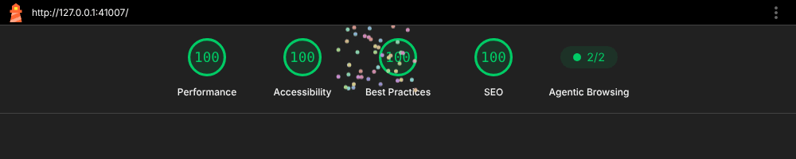

# server

A static web server for a single-page app, in one Node file, with nothing to install.

* **Simple setup** — `npm start`. No build step to run, no config file, no `npm install`.
* **No npm dependencies** — `node:http`, `node:fs`, `node:zlib`. Not for running, building or testing.
* **100/100 Lighthouse out of the box** — every category, mobile and desktop, measured against the real server.
* **A PWA that updates itself** — versioned precache, offline shell, update prompt, installable.
* **Does what a static host does** — safe paths, brotli, typed caching, ETags, SPA fallback, security headers.
* **Agent friendly** — `AGENTS.md`, a skill, an MCP endpoint, one command that verifies everything.

<p align="center">

</p>

Live at **[server.herton.work](https://server.herton.work)** — that copy is GitHub Pages serving `public/`, so the
live-status panel says so; clone it and `npm start` to see the server itself answer.

## Run it

Serve any folder, with nothing to clone or install:

```sh
npx @labs_kai/server dist            # → http://127.0.0.1:2211
```

Or clone it to start from the bundled page and PWA:

```sh
git clone https://github.com/hertonwork/server.git
cd server
npm start            # serves public/
```

`index.html` is the shell every client-side route falls back to, `404.html` the not-found page. The rest is a flag or
an environment variable (flags win):

| Flag | Variable | Default | What it does |
| --- | --- | --- | --- |
| `[folder]` | `PUBLIC_DIR` | `./public` if it exists, else `.` | Folder to serve |
| `-p, --port` | `PORT` | `2211` | Port to listen on (`0` picks a free one) |
| `--host` | `HOST` | `127.0.0.1` | Bind address. `0.0.0.0` in a container or to reach it from another machine |
| `-v, --verbose` | `VERBOSE` | off | One log line per request |
| `--mcp` | `MCP` | off | Answer MCP clients (coding agents) at `/mcp` — see [MCP](#mcp) |
| | `TLS_KEY`, `TLS_CERT` | `key.pem`, `cert.pem` | When both files exist the server speaks HTTPS |

```sh
npx @labs_kai/server dist --port 8080 --host 0.0.0.0
PORT=8080 HOST=0.0.0.0 npm start
npm run dev          # verbose, restarts when a file changes
npm run cert         # self-signed localhost certificate → the next `npm start` is https
npm test             # the server's tests (node:test, over a real socket)
npm run check        # tests + build + preflight + Lighthouse against this server
```

Behind nginx or Caddy you don't need the certificate: the proxy terminates TLS and talks plain HTTP to `127.0.0.1:2211`.

```nginx
location / {
    proxy_pass http://127.0.0.1:2211;
    proxy_http_version 1.1;
    proxy_set_header Host $host;
    proxy_set_header X-Forwarded-Proto $scheme;
}
```

## What the server does

| | |
| --- | --- |
| **Safe paths** | Every URL is resolved inside `public/`; `../`, encoded dots and doubled slashes can't escape it. Dotfiles (`.env`, `.git`) are hidden, `/.well-known/` is not |
| **SPA fallback** | Extension-less paths (`/about`, `/users/42`) get `index.html` with a 200 so client-side routing works. Unknown `/api/*` paths and non-HTML requests get a real 404 |
| **Correct types** | Content-Type with charset for text, `image/x-icon`, `font/woff2`, `application/manifest+json`, `application/wasm`, … |
| **Caching** | HTML, `sw.js` and the manifest: `no-cache` (always revalidated, so deploys show up at once). Assets: one day. Fingerprinted assets (`app.3f9c2a1b.js`): one year, `immutable`. Weak ETags and `Last-Modified` → 304s |
| **Compression** | Brotli or gzip for text over 1 KB, `Vary: Accept-Encoding` |
| **Range requests** | `<video>` and `<audio>` seek with `206 Partial Content` |
| **Security headers** | `X-Content-Type-Options`, `Referrer-Policy`, `X-Frame-Options`; HSTS when the connection is TLS |
| **Robust** | Malformed URLs → 400, `POST` → 405, a file that disappears → 404, an unexpected error → 500. Never a crash |
| **Health** | `GET /api/health` → `{ ok, started, uptime, requests, node }` |

### Use it as a module

```sh
npm i @labs_kai/server
```

```js
import { createServer } from '@labs_kai/server';     // in a clone: './lib/simple-server.js'

createServer({
  publicDir: 'dist',
  maxAge: 3600,
  headers: { 'Permissions-Policy': 'camera=()', 'X-Frame-Options': null },   // add one, drop one
  routes: {
    'GET /api/time': () => ({ now: Date.now() }),                           // return an object → JSON
    'POST /api/echo': (req, res) => { req.pipe(res); },                     // or write the response yourself
  },
}).listen(2211);
```

`createHandler(options)` returns just the `(req, res)` function if you want to mount it on your own server; `mcp: true`
adds the [MCP](#mcp) endpoint. All options and their defaults are at the top of
[`lib/simple-server.js`](lib/simple-server.js). The package is 16 KB: the server, the MCP endpoint and the command.

## The page

`public/index.html` is the server's demo and the shell your app replaces: one HTML file with no request for JS, CSS or
fonts. It is built from `site/` with [sscss](https://github.com/hertonwork/sscss) (a vocabulary of tiny utility
classes; the build generates exactly the rules the page uses, 2.5 KB) and [Minim](https://github.com/hertonwork/minim)
(a 2.5 KB reactive library; the state is a JSON tag, the markup binds to it by key). On it:

* a **request inspector** — pick a path, the page fetches it from this server and shows the status and the headers
  that matter (type, caching, encoding, ETag), including what a traversal attempt gets;
* a **live status panel** — `/api/health` every ten seconds: requests served, uptime, Node version;
* the **PWA state** — service worker, cache version, network, install and update buttons;
* a **hero animation** — lanes running to a horizon, requests flowing in and responses coming back, drawn by a
  fragment shader from Minim's [shader-hero](https://github.com/hertonwork/minim/tree/main/skills/shader-hero) skill.
  It runs only on real GPUs and starts after the page has loaded, so the score doesn't move.

```sh
npm run build        # site/ → public/index.html, public/404.html, public/sw.js
npm run check        # + preflight + Lighthouse (npm i -g lighthouse; CHROME_PATH if Chrome isn't found)
npm run vendor       # refresh vendor/ (Minim, the sscss generator, the preflight) from their repositories
npm run shots        # manifest screenshots + preview.jpg from the running server (Playwright)
npm run fireworks    # the Lighthouse report's fireworks as public/lighthouse.gif (Playwright + ImageMagick)
```

Every push to `main` publishes `public/` to GitHub Pages (`.github/workflows/pages.yml`).

## The PWA

* `manifest.webmanifest` with an `id`, maskable icon, a shortcut and screenshots — installable on Android, desktop
  Chrome and Edge, Safari.
* `sw.js` is generated: its version is a hash of every file it precaches, so a deploy that changes something is a new
  cache and one that changes nothing leaves installed workers alone. The shell, the not-found page, the manifest and
  the icons are precached; a navigation that can't reach the network gets the shell, so the app opens offline; other
  files are served from cache and refreshed in the background.
* When a new version is installed behind an open page, the page shows **"A new version is ready — Reload"**; one tap
  activates it. The server sends `sw.js` and the manifest with `no-cache`, so browsers see a deploy at once.

## For agents

The repository is laid out to be worked on by coding agents as much as by people:

* [`AGENTS.md`](AGENTS.md) — the layout, the commands, and the rules that keep the project what it is (zero
  dependencies, nothing served outside `public/`, never a crash, the page stays at 100).
* [`skills/simple-server/`](skills/simple-server/SKILL.md) — a skill that teaches an agent to serve a project with it
  and to build and verify a page the way the bundled one was built. `npx skills add hertonwork/server`.
* `npm run check` — tests, build, preflight and Lighthouse in one command, the same thing CI runs.
* An MCP endpoint, so an agent can ask the running server what it serves and how it answers — below.

## MCP

Start it with `MCP=1` and coding agents can talk to it at `/mcp`:

```sh
npx @labs_kai/server dist --mcp      # in a clone: npm run mcp
claude mcp add --transport http server http://127.0.0.1:2211/mcp
```

| Tool | Answers |
| --- | --- |
| `health` | uptime, requests served, Node version |
| `list_files` | what `public/` serves: URL path, size, Content-Type |
| `read_file` | a text file's contents (for other files: size and type) |
| `inspect` | how the server answers a path: status, headers (cache, compression, ETag), size, the start of the body |

Everything is read-only and goes through the server's own path rules and handler, so a tool never sees more than a
browser could. It is one file, [`lib/mcp.js`](lib/mcp.js), with no SDK: Streamable HTTP, one JSON answer per request,
no sessions. It speaks both eras of the protocol: **2026-07-28** (`server/discover`, the version on every request, as
Claude Code sends it) and **2025-11-25 back to 2025-03-26** (`initialize` first, as the official TypeScript SDK 1.x
does). A browser may only call it from a page on this machine (DNS-rebinding protection). Keep it off on a public
deployment: what it shows is public anyway, but a file listing is not something to publish.

## License

[MIT](https://opensource.org/licenses/MIT)
