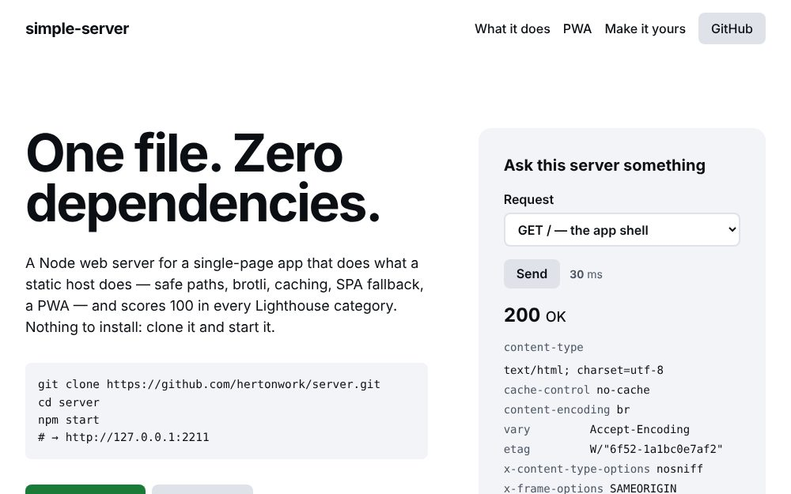

# simple-server

A static web server for a single-page app, in one Node file, with nothing to install.

* **Simple setup** — `npm start`. No build, no config file, no `npm install`.
* **No npm dependencies** — `node:http`, `node:fs`, `node:zlib`. That's it.
* **100/100 Lighthouse out of the box** — the bundled page scores 100 in every category.
* **PWA** — manifest, service worker, offline page, installable.
* **Does the real work a static host does** — safe paths, compression, caching, ETags, SPA fallback, security headers.

## Preview

<p align="center">

</p>

## Run it

```sh
git clone https://github.com/hertonwork/simple-server.git
cd simple-server
npm start            # → http://127.0.0.1:2211
```

Put your app in `public/`. `index.html` is the shell, `404.html` the not-found page. Everything is configured with environment variables:

| Variable | Default | What it does |
| --- | --- | --- |
| `PORT` | `2211` | Port to listen on |
| `HOST` | `127.0.0.1` | Bind address. Use `0.0.0.0` in a container or to reach it from another machine |
| `PUBLIC_DIR` | `public` | Folder to serve |
| `VERBOSE` | off | `VERBOSE=1` logs one line per request |
| `TLS_KEY`, `TLS_CERT` | `key.pem`, `cert.pem` | When both files exist the server speaks HTTPS |

```sh
PORT=8080 HOST=0.0.0.0 npm start
npm run dev          # verbose, restarts when a file changes
npm run cert         # self-signed localhost certificate → next `npm start` is https
npm test             # the server's test-suite (node:test, no dependencies either)
```

Behind nginx or Caddy you don't need the certificate: the proxy terminates TLS and talks plain HTTP to `127.0.0.1:2211`.

```nginx
location / {
    proxy_pass http://127.0.0.1:2211;
    proxy_http_version 1.1;
    proxy_set_header Host $host;
    proxy_set_header X-Forwarded-Proto $scheme;
}
```

## What the server does

| | |
| --- | --- |
| **Safe paths** | Every URL is resolved inside `public/`; `../`, encoded dots and doubled slashes can't escape it. Dotfiles (`.env`, `.git`) are hidden, `/.well-known/` is not |
| **SPA fallback** | Extension-less paths (`/about`, `/users/42`) get `index.html` with a 200 so client-side routing works. Unknown `/api/*` paths and non-HTML requests get a 404 |
| **Correct types** | Content-Type with charset for text, `image/x-icon`, `font/woff2`, `application/manifest+json`, … |
| **Caching** | HTML, `sw.js` and the manifest: `no-cache` (always revalidated). Assets: one day. Fingerprinted assets (`app.3f9c2a1b.js`): one year, `immutable`. Weak ETags and `Last-Modified` → 304s |
| **Compression** | Brotli or gzip for text over 1 KB, `Vary: Accept-Encoding` |
| **Range requests** | `<video>` and `<audio>` seek with `206 Partial Content` |
| **Security headers** | `X-Content-Type-Options`, `Referrer-Policy`, `X-Frame-Options`; HSTS when the connection is TLS |
| **Robust** | Malformed URLs → 400, `POST` → 405, a file that disappears → 404, an unexpected error → 500. Never a crash |
| **Health** | `GET /api/health` → `{ ok, started, uptime, requests, node }` |

## Use it as a module

```js
import { createServer } from './lib/simple-server.js';

createServer({
  publicDir: 'dist',
  maxAge: 3600,
  headers: { 'Permissions-Policy': 'camera=()', 'X-Frame-Options': null },   // add one, drop one
  routes: {
    'GET /api/time': () => ({ now: Date.now() }),                           // return an object → JSON
    'POST /api/echo': (req, res) => { req.pipe(res); },                     // or write the response yourself
  },
}).listen(2211);
```

`createHandler(options)` returns just the `(req, res)` function if you want to mount it on your own server. All options and their defaults are at the top of [`lib/simple-server.js`](lib/simple-server.js).

## License

[MIT](https://opensource.org/licenses/MIT)
